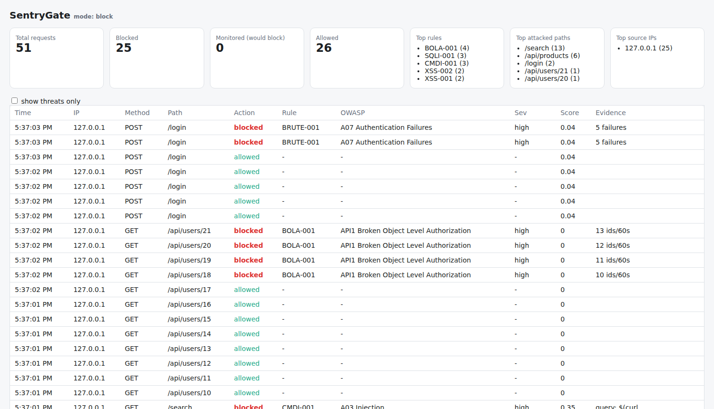

# SentryGate: Intelligent Web & API Protection Gateway

A small reverse-proxy security gateway (FastAPI + SQLite) that sits in front of a web app or API,
inspects every request, blocks common attacks and shows everything on a live dashboard.
Built as the final project of the **CyberFox Internship Program** (Web & API Security, blue team).

> **Use only on apps you own or on intentionally vulnerable lab apps.** This is an educational
> prototype, not a production WAF.



## How it works

```
Client -> SentryGate :8080 -> protected app :9000
              |
              +-- rule engine (SQLi, XSS, traversal, cmd-injection, scanners)
              +-- behaviour checks (rate limit, brute force, BOLA enumeration)
              +-- anomaly score (0-1 heuristic) -> decision (block / monitor / flag / allow)
              +-- SQLite event log -> live dashboard
```

1. **Rule engine** (`rules.py`): regex signatures; input is URL-decoded and HTML-unescaped up to 3 times
   (defeats double encoding), SQL comments (`/**/`) are stripped, and JSON bodies are flattened before scanning.
2. **Behaviour checks** (`gateway.py`): per-IP rate limiting (RATE-001), failed-login lockout (BRUTE-001),
   object-ID enumeration (BOLA-001, OWASP API1).
3. **Anomaly score** (`rules.anomaly_score`): length + special-character ratio + entropy. A heuristic baseline, not a trained model.
4. **Decision + logging** (`store.py`): every request is stored with rule ID, OWASP category, severity and score.
   `SENTRY_MODE=monitor` logs "would block" without blocking (safe tuning mode).
5. **Dashboard** (`dashboard.html`): totals, top rules / paths / IPs and a live event table (localhost-only or token-protected).

## Quick start

```bash
pip install -r requirements.txt

uvicorn demo_backend:app --port 9000    # terminal 1: intentionally vulnerable lab app
uvicorn gateway:app --port 8080         # terminal 2: SentryGate in front of it
python attack_test.py                   # terminal 3: detection rate + false positives
```

Dashboard: <http://127.0.0.1:8080/_sentry/>

**Docker** (backend stays on the internal network, only the gateway is published on localhost):

```bash
docker compose up --build
# dashboard: http://127.0.0.1:8080/_sentry/?token=change-me
```

## Configuration

| Variable | Default | Meaning |
|---|---|---|
| `BACKEND_URL` | `http://127.0.0.1:9000` | Application being protected |
| `SENTRY_MODE` | `block` | `block`, or `monitor` (log only) |
| `RATE_LIMIT` | `60` | Requests per 10 s per client IP |
| `SENTRY_TOKEN` | unset | Dashboard token (otherwise localhost only) |
| `SENTRY_DB` | `sentry.db` | SQLite file location |

## Results (local lab, `python attack_test.py`)

| Metric | Result |
|---|---|
| Attack scenarios detected | **22 / 22 (100 %)**: SQLi 7, XSS 5, traversal 3, command injection 4, BOLA, brute force, rate limit |
| False positives on legitimate traffic | **0 / 20 (0 %)**: includes awkward searches such as "sleep mask", "2 and 2=4", "dads' #1 gift" |
| Latency overhead (`benchmark.py`, 300 sequential requests) | about **3.7 ms** per request (0.9 ms direct vs 4.5 ms via gateway) |
| Automated tests (`python -m pytest`) | **28 passed** |

Raw numbers are saved in `results/`. These figures come from a small, self-written corpus on localhost.
They show the controls work as designed. They are **not** a benchmark against real-world attack traffic.

## Project structure

```
gateway.py        reverse proxy, behaviour checks, admin API
rules.py          normalisation, signatures, anomaly score
store.py          SQLite event store
dashboard.html    live dashboard (uses textContent only, log data is attacker-controlled)
demo_backend.py   LAB-ONLY vulnerable app (SQLi, XSS, BOLA, weak login)
attack_test.py    evaluation: detection rate + false positives -> results/evaluation.json
benchmark.py      latency with vs without the gateway -> results/benchmark.json
tests/            pytest unit + pipeline tests
```

## Limitations

- Regex signatures can be bypassed by novel payloads; real WAFs layer far more rules (OWASP CRS / ModSecurity).
- Rate, brute-force and BOLA counters are in memory and per process (reset on restart, not shared between instances).
- IP-based controls can affect users behind one shared NAT address; the client IP is the direct socket address.
- No TLS termination, WebSocket support or response-body inspection.
- BOLA-001 detects enumeration *behaviour*; it cannot prove an ownership-check bug.
- The anomaly score is a hand-tuned heuristic, not machine learning.

## Roadmap

Isolation Forest trained on logged normal traffic, OpenAPI schema validation, Redis-backed counters,
alerting (email / Telegram), comparison with ModSecurity + CRS.

## Author

Ahmad Asghar, CyberFox Internship Program, 2026. Licensed under MIT.
